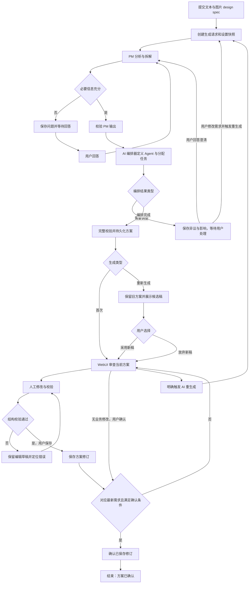
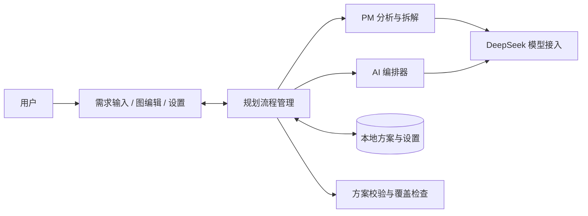

# 通用 Agent 工作流产品与架构设计

日期：2026-11-15  
定位：跨领域 Agent 编排规划与人工审查 MVP  

### 文档约束层级

本文明确产品目标、用户行为、已确认的技术方向及必要的外部 API 规则。框架、库、字段名、路由、目录、数据结构、状态编码及并发和重试的具体实现由开发阶段选择；文中的逻辑对象和示例不作为固定代码模板。验收以可观察的行为和结果为准。

## 1. 产品目标与本期边界

### 1.1 产品目标

用户提交 design spec，PM agent 完成需求分析、必要澄清和任务拆解；AI 编排器据此动态定义所需 Agent 的角色、职责、系统提示词、能力需求及任务分配。WebUI 以任务依赖图关联 Agent 的方式呈现方案，用户直接修改图和属性，校验后保存并确认。

**核心流程：文本与图片需求 → PM 分析、澄清与拆解 → AI 编排器定义 Agent 并分配任务 → 可视化审查与调整 → 确认已保存方案。**

本期实际运行的 AI 只有 PM agent 和编排器，二者均通过 DeepSeek API 调用。编排好的下游 Agent 是方案中的定义数据，不创建运行实例、不调用模型、不调用其描述的工具。确认只表示用户接受该编排修订，不表示任务完成或原始业务目标已实现。

### 1.2 通用与可定制

- 跨领域需求使用同一套分析、任务和 Agent 契约，覆盖软件研发、研究分析、内容策划等，不预置固定业务角色集合。
- 编排器本身是 AI Agent，根据任务决定角色数量和分工；一个 Agent 可以负责多个任务，每项任务只有一个主要负责 Agent。
- 用户可编辑本次任务图、Agent 定义和分配，也可在设置页编辑 PM 与编排器提示词、三类默认思考强度。
- “需要检索资料”“需要代码编辑能力”等能力需求只声明未来执行条件，不代表已经接入、授权或验证可用。

### 1.3 MVP 范围

| 范围 | 本期能力 |
|---|---|
| 使用场景 | 本地单人、浏览器操作、本地后端及持久化 |
| 输入 | 文本输入/粘贴、图片上传/粘贴、预览与移除未提交图片 |
| PM | 澄清、需求分析、验收条件、任务及依赖拆解 |
| AI 编排器 | 动态 Agent 角色、职责、系统提示词、能力需求及任务分配 |
| WebUI | 任务依赖图、Agent 清单、属性编辑、需求覆盖清单 |
| 编辑 | 增删任务和 Agent、修改依赖与分配、撤销重做、布局整理 |
| 生成控制 | 流式展示、取消、失败重试、反馈重生成和候选比较 |
| 保存与确认 | 本地方案列表、保存修订、重开、确认具体修订 |
| 设置 | 默认提示词、恢复默认、PM/编排器/下游 Agent 三类默认思考强度 |

本期不包含下游任务执行、执行调度器、Worker、租约、工具执行、业务结果汇总、暂停续跑或模型输出断点续写；规划阶段已校验结果的复用按第 6.2 节处理。不包含 PDF/Word 解析、网页抓取、联网搜索、账号系统、多人协作、插件市场、模板市场、计费或执行引擎。官方 API 资料来源见第 15 节。

### 1.4 成功标准

1. 文本与图片进入真实 PM 请求；必要信息缺失时提问，充分时自动衔接编排。
2. 生成完整的动态 Agent 定义，每个任务均有负责者，依赖和预期输入输出可以审查。
3. 用户可直接改图和属性；无效结果不会成为有效方案，错误能定位到任务、连线或字段。
4. 保存内容在刷新和服务重启后可恢复；新稿及迟到响应不能覆盖人工修改。
5. 确认方案后不发生下游调用，界面不宣称任务已执行或业务目标已完成。

## 2. 用户流程

### 2.1 首次规划

1. 创建工作流，提交文本、图片或二者。允许仅图片输入，两者均为空则拒绝。原始输入和图片引用持久化。
2. 后端校验输入与 API Key，创建生成请求并冻结设置快照，调用 PM。
3. PM 缺少关键条件时返回结构化澄清问题，保存后等待回答，不空转调用。回答关联问题，已明确的信息不重复询问。
4. 信息充分后，PM 输出需求、验收条件、任务和依赖；后端校验后自动调用编排器，无需阶段审批。
5. 编排器生成 Agent 定义及任务分配；后端与 PM 的任务图合并，完整校验。若编排器返回需要调整的问题，则保存问题并按第 3.3 节等待用户处理，不作为成功方案。
6. 首次合法方案落库，成为当前已保存、未确认修订；WebUI 展示需求摘要、任务图、角色和覆盖提醒。
7. 用户调整后点击“保存方案”，生成新修订；无未保存业务修改且满足确认条件时，点击“确认方案”。
8. 显示“编排方案已确认；下游 Agent 尚未执行”，流程结束。

### 2.2 主流程图



失败按第 11 节处理，不越过失败阶段。所有路径结束于方案层，不连接下游执行。

### 2.3 修改与重新生成

人工编辑不调用模型。任务目标、任务完成条件、依赖、Agent 定义及分配均可修改。需求级验收条件与任务级完成条件区分：改变整体目标或需求级验收条件，通过“补充/修改需求”建立输入新修订，再经 PM 更新分析；不能通过删除任务静默删掉需求。

每个方案修订和候选稿必须关联生成时依据的需求修订及 PM 验收条件。已提交需求发生变化后，原方案保留并标为“对应旧需求”，原确认只对原需求和原方案有效；仅编辑旧方案不能将其关联改为新需求。需求变化后须经 PM 重新分析并生成对应新需求的方案，才能确认。PM 若提出新增、删除或实质改变用户已明确要求的建议，须先澄清，不能以重新分析为由自行改写这些要求。

重生成由用户明确触发，可附意见；有未保存修改时应明确如何保留或处理。重生成重新经过 PM 和编排器，输入包含最新需求、当前方案、人工修改摘要和本次反馈。生成期间保护原方案与人工修改，是否暂时只读由交互及实现选择。

新稿完整校验后作为候选保留，原方案继续保留。WebUI 比较需求版本、需求及验收条件的增删改，以及任务、依赖、Agent、分配及下游默认配置差异，用户选择采用或放弃，不自动覆盖。放弃候选不会回退已提交的最新需求；原方案若对应旧需求，仍保持过期标记且不能再次确认。若生成期间又提交了新需求，迟到候选保留其原需求关联并标为过期，不能自动成为最新需求的方案。

## 3. Agent 职责与信息交接

### 3.1 角色边界

| 对象 | 主要输入 | 职责与产出 |
|---|---|---|
| PM agent | 用户的文本、图片、澄清回答，以及重新规划时的原方案与反馈 | 明确需求、验收条件，拆解任务与依赖；必要时提问 |
| AI 编排器 | PM 分析与任务拆解、资料、规划偏好和下游默认配置 | 动态定义 Agent 角色、职责、系统提示词、能力需求和任务分配，说明理由 |
| 下游 Agent | 编排器生成或用户修改的定义 | 本期只作为方案内容供查看、编辑和保存，不实际运行 |
| 应用服务 | 用户操作、模型结果和已保存方案 | 管理规划流程、校验、保存、取消和界面反馈 |

PM 与编排器是不同的逻辑职责，不要求对应独立进程、服务、类或代码模块。实现可以共用模型连接和基础设施。

### 3.2 PM 交付内容

PM 应清楚区分“需要澄清”和“可以进入编排”两种结果。澄清内容包括问题、必要原因及已有信息，允许自由文本回答；建议答案不会自动视为用户已作答。

信息充分时，输出目标、受众、交付物、约束、排除项、关键假设、验收条件、任务和依赖。任务应有明确目标、输入来源、预期输出、完成条件及对应的验收要求。前置任务的产物表达的是未来交付约定，不是现成结果。

MVP 中纳入当前需求的验收条件全部视为必需项，不提供“可选验收项”或通过降级要求绕过确认校验的能力。用户明确的可选设想先作为范围外备选记录；是否纳入当前需求有歧义时先澄清。增删或改变验收条件须通过需求修改及 PM 更新分析，不能仅修改任务关联来改变要求。

模型结果需要采用便于程序处理和校验的结构化形式。字段名、对象拆分、类型声明和序列化组织由实现确定，不以本文术语作为固定代码命名。

### 3.3 编排器交付内容

每个下游 Agent 应包含角色名、职责、系统提示词和能力需求；方案应明确每项任务的主要负责 Agent，允许一个 Agent 负责多个任务。应说明主要分工理由与必要的交接关系。

编排器依据 PM 拆解进行编排，不静默改变已确定的需求与任务。输出区分“编排完成”和“需要调整”：后者包含问题、原因、受影响需求或任务，以及待用户回答的问题或建议修改项。合法的异议不是格式错误，不触发自动修复重试，也不生成有效方案。

应用保存并展示异议后停止自动推进。用户回答澄清后，由 PM 使用原需求、已有问答及异议重新分析，再进入编排；用户修改需求时建立新需求修订，并明确触发重生成。尚未处理的异议在刷新和服务重启后仍可恢复。编排器再次提出异议时继续等待用户处理，不允许 PM 与编排器自动循环调用。

下游 Agent 统一使用方案对应的默认模型及思考强度，不开放逐个覆盖。角色、职责、提示词和能力需求可逐个编辑。

## 4. 技术方向与架构原则

### 4.1 已确定方向与可选实现

| 层次 | 方向与自由度 |
|---|---|
| 前端 | 沿用 React + TypeScript 的 WebUI 与可视化图编辑方向；Vite、React Flow、Ant Design 为现有参考组合 |
| 后端 | 使用 TypeScript / Node.js；具体 Web 框架、模型 SDK、校验及状态管理库由实现选择 |
| 本地保存 | 使用本地数据库保存方案与设置；数据库产品、表结构、图片存储方式及目录由实现选择 |
| 模型接入 | DeepSeek Chat Completions，支持文本与图片、流式响应；可以使用兼容 SDK 或直接请求 |
| 前后端通信 | 支持生成进度、结果同步和重新打开恢复；通信协议及接口组织由实现选择 |

Fastify、SQLite、Dagre、SSE 等可以作为实现参考，不是验收指定项。开发端口、目录、文件名、部署打包方式、依赖版本及模块组织无需按本文固定。技术选择应适合本地单人场景，避免为本期引入不必要的部署负担。

API Key 仍通过后端 `.env` 的环境变量配置，不进入浏览器配置或用户可见响应。已确认的产品范围、模型选择和数据保护要求不因具体实现方式改变。

### 4.2 逻辑架构



图中表达职责与数据流，不规定代码分层、组件数量或服务拆分。下游 Agent 不在本期调用链中。

### 4.3 实现应保证的结果

- 界面中的“已保存”和“已确认”与实际保存结果一致，失败不能显示成功。
- 有效方案、未保存修改和生成中的预览可以区分，模型更新不能无声覆盖人工编辑。
- 取消、重试和重新生成能够区分不同请求，旧响应不会替换新结果。
- 布局变化不改变任务依赖或确认内容，正常进度更新不打乱用户正在查看的画布。

## 5. 需要保存的信息与设置

### 5.1 信息范围

| 信息 | 需要表达的内容 |
|---|---|
| 原始需求与资料 | 用户文本、图片、补充要求及来源、需求修订，保留与对应请求关联的澄清问答 |
| PM 分析 | 目标、范围、约束、假设、验收条件和任务拆解 |
| 任务及依赖 | 任务目标、输入来源、预期输出、完成条件、验收关联、负责 Agent 与前后关系 |
| Agent 定义 | 角色、职责、系统提示词、能力需求和负责任务 |
| 编排方案 | 本次任务图、角色和分配、编排理由、关联的需求修订与 PM 验收条件 |
| 生成信息 | 当前阶段、完成或失败情况、取消情况、编排异议、已校验阶段结果及必要的调用信息 |
| 设置依据 | 生成时使用的提示词、三类默认思考强度和请求模型标识 |
| 保存与确认 | 当前已保存内容、候选稿、确认所针对的方案与需求修订及时间 |
| 编辑草稿 | 与正式方案分开的编辑内容、对应基础方案修订及草稿保留状态 |
| 画布布局 | 恢复查看和编辑所需的节点位置等信息 |

这些是信息要求，不是数据库表、接口字段、文件格式或 TypeScript 类型定义。可按实现合并或拆分；对象如何标识、修订如何存储、引用如何表达由实现确定。需要能够区分不同任务、Agent 和方案，并使引用可检查、历史确认可追溯。

### 5.2 任务交接与需求关联

用户应能看出任务输入来自需求、图片还是前置任务的预期输出。依赖与输入引用应一致，删除或修改前置任务时提示影响。可以采用产物名称、引用标识或其他清楚的表达，不强制输出 key、路径语法或特定引用结构。

任务与验收条件的关联用于检查规划覆盖情况，不代表业务需求已经实现。

### 5.3 设置及生效范围

设置页提供以下配置，名称和控件形式由实现确定：

| 配置 | 默认与行为 |
|---|---|
| PM 默认思考强度 | 默认 high，可选 low / high / max |
| 编排器默认思考强度 | 默认 high，可选 low / high / max |
| 下游 Agent 默认思考强度 | 默认 high，可选 low / high / max，所有下游 Agent 统一使用 |
| PM 提示词 | 提供默认内容，支持编辑和恢复默认 |
| 编排器提示词 | 提供默认内容，支持编辑和恢复默认 |

请求模型标识固定为 `deepseek-flash`，思考模式开启。该标识对应的底层模型可能由服务商更新，不表示固定模型权重或保证重复生成相同结果。密钥从后端环境读取，不通过设置页展示或保存。

后续新生成使用新设置；正在进行的生成、其澄清和异议处理、自动重试及用户主动重试均继续使用原设置。已有方案不因全局设置变化而静默改变。保留每次生成使用的设置依据。

人工编辑并保存不自动改变原方案的模型设置。需要使用新设置重新规划时，用户明确触发重生成并审查新稿。

## 6. 生成过程、取消与恢复

### 6.1 状态表达

用户能区分正在分析、等待回答、正在编排、等待处理编排异议、正在校验、生成完成、失败、已取消或中断。

生成状态、保存状态和确认状态需要分开表达。“方案生成完成”不能写成任务已执行；下游任务不显示虚假的执行进度或成功状态。

### 6.2 取消与重试

用户可以取消当前生成，取消生效后不再自动推进后续阶段，迟到结果不覆盖当前方案或新请求。取消与成功同时发生时，向用户返回一致的最终结果。是否中断连接、如何判断接纳资格由实现处理。

本地取消不保证服务商立即停止计算。失败、中断或取消后用户可主动重试；每次重试建立独立调用尝试，沿用原生成请求的需求、图片、已提交回答、反馈和设置依据，不吸收后来产生的编辑或全局设置变更，旧尝试的迟到响应仍不得被接纳。自动重试和输出修复共同受本次调用的有限预算约束，不能形成无限调用。

重试从失败或中断阶段重新发起完整阶段请求；原请求已有持久化且校验通过的上游结果时复用该结果，不重跑成功阶段。若完整结果已校验但仅保存失败，先重试保存，不再次调用模型。缺少可用的上游结果时，从最早缺失阶段重新生成，并在操作前说明将重跑哪些阶段。取消后只有用户明确重试才可重新调用。这不包含拼接半段模型输出或下游执行续跑。

使用新需求、新反馈、新设置或当前方案的新修改属于“重生成”，须重新经过 PM 和编排器；已有方案时产出候选，按第 7 节审查。若原请求依据的需求已过期，禁止以“重试”继续，提示针对最新需求重新生成。

### 6.3 刷新与服务重启

刷新、重新打开或断线恢复后可以继续查看已保存方案、图片、设置及确认情况，不因页面重连重复启动付费调用。每次业务编辑后自动独立保留草稿，允许合并短时间内的连续输入；保留完成前显示“草稿保留中”，完成后显示“草稿已保留”，失败则显示“草稿保留失败”，与正式方案保存状态区分。已显示“草稿已保留”的内容，在同一浏览器正常存储环境下刷新或重新打开后必须可恢复，服务重启不使其消失；保留失败或尚未完成时不得显示成功，离开页面时提示风险。

恢复草稿时检查其对应的基础方案修订；正式方案已变化时展示冲突，保留双方内容并由用户选择处理，不能将旧草稿直接覆盖新方案。此恢复承诺不包含浏览器数据被主动清除或存储介质损坏。

服务重启后不能假装中断的生成已经成功，也不默认重放尚未完成的付费调用。提示用户当前情况及重试入口，等待澄清的问题仍可恢复。并发数量、排队策略、恢复机制及浏览器草稿的保存方式由实现选择。

## 7. 编辑、保存、候选选择与确认

### 7.1 编辑体验

任务为节点，边表示前后依赖，节点展示负责 Agent；用户可以查看 Agent 定义及其负责任务。PM 和编排器作为规划阶段显示，不混入下游任务图。

支持增删任务和 Agent、修改属性、任务分配与依赖，以及撤销重做和布局调整。删除被引用对象时展示影响，要求处理相关依赖和分配，不静默猜测替代关系。

生成和编辑可能同时发生时，要保护人工修改。界面可采用暂时只读、保存提示或冲突处理等方式；本文不指定编辑锁或会话机制。

### 7.2 校验与覆盖

| 类别 | 需要保证的结果 |
|---|---|
| 内容完整性 | 任务目标、预期产物、完成条件及 Agent 职责、提示词明确 |
| 依赖关系 | 不存在自环、循环或引用已不存在任务的情况 |
| 任务分配 | 每项任务有明确、存在的主要负责 Agent |
| 输入输出 | 输入来源、预期交接和依赖一致，相关资料可定位 |
| 需求覆盖 | 显示各项验收要求对应的任务，提示遗漏 |
| 语义及能力 | 提醒用户审查分工是否充分、能力需求是否仍待接入 |

错误应能定位到相关任务、连线或属性。缺少必填内容、循环、悬空引用、未分配任务等结构错误阻止“保存方案”和确认，但允许保留独立的编辑草稿；草稿不成为正式方案修订，也不替换此前有效方案。结构合法但验收覆盖不足的方案可以保存为未确认修订；当前需求的全部验收条件均为必需项，有任何遗漏就不能确认。

覆盖关联不等于语义充分，更不等于需求已经实现。能力需求可以没有额外声明，用户不能通过删除任务让原始验收要求无声消失。

### 7.3 保存与候选选择

用户可以保存修改并重新打开。保存失败保留已有有效方案及可恢复的编辑草稿并明确提示；重复操作和过期提交不能导致无声覆盖。“保存方案”成功后，草稿基线随之更新，避免重新打开时将已保存修改误报为冲突。

AI 重生成保留原方案，新稿作为候选供用户比较。只有明确采用才能替换当前方案；放弃新稿保留原内容。采用后的新方案需要确认。保留足以区分方案和追溯确认的信息，不要求完整历史浏览器或导出功能。

### 7.4 确认

确认必须针对明确、已保存且校验通过、关联最新已提交需求修订的方案；必要澄清和对应方案的编排异议已解决，全部验收条件已有关联任务。未保存业务修改、待处理候选或未解决的新旧方案冲突需要先处理。确认时再次校验需求及方案修订仍为用户审查的版本，过期确认请求不得生效。确认操作应明确表示用户已审查方案。

已确认内容发生业务修改后需要重新保存、确认，保留对原内容的确认记录；仅布局变化不影响确认。需求变化后原方案标为“对应旧需求”，历史确认继续可查，但不能再次确认该旧方案，也不能冒充对新需求的确认。放弃新候选不会解除这一限制。

确认始终结束于规划方案，不触发下游模型或工具调用。

## 8. 前后端协作能力

### 8.1 需要支持的操作

| 能力 | 对外行为 |
|---|---|
| 需求与资料管理 | 创建需求、提交文本图片、补充或修改需求、恢复已有资料 |
| 规划生成 | 发起分析与编排、回答澄清问题、处理编排异议、取消、失败后重试 |
| 方案管理 | 列表、读取、校验、保存、重新打开、独立保留及恢复编辑草稿 |
| 候选审查 | 查看差异、采用或放弃 AI 新稿 |
| 确认 | 确认明确的已保存方案，读取确认结果 |
| 设置 | 读取、编辑、保存三类强度及两类提示词，恢复默认 |
| 进度同步 | 展示阶段、内容预览、生成结果、失败与取消情况 |

创建需求与开始生成可合并或分开，但重复提交不能重复启动生成。

### 8.2 同步及错误反馈

前后端需要一致反映保存、确认、生成和取消结果。断线恢复不能漏掉最终结果或重复计入更新，事件或消息顺序异常不能覆盖较新的方案。可采用 SSE、WebSocket、状态查询或组合方案，不指定事件信封、游标或持久化方式。

错误反馈应说明失败环节、可采取的操作，并保留用户可恢复的输入或修改。模型预览按内容安全渲染，不执行生成的代码或页面脚本，不公开密钥及原始思考内容。

## 9. WebUI 信息架构

### 9.1 主要区域

| 区域 | 内容与操作 |
|---|---|
| 方案列表 | 新建、状态、更新时间、重新打开 |
| 需求与对话 | 原始文本图片、澄清问答、补充需求和重生成反馈 |
| 生成概览 | 当前阶段、耗时、取消、错误、重试所用输入及阶段、待处理编排异议 |
| 任务画布 | 任务、依赖、负责 Agent、缩放与布局调整 |
| 任务属性 | 目标、输入、输出、完成条件、验收关联和任务分配 |
| Agent 属性 | 角色、职责、系统提示词、能力需求、负责任务及统一默认配置 |
| 校验与覆盖 | 问题定位、验收覆盖、能力提醒 |
| 方案操作 | 草稿保留状态、保存、重新生成、候选差异与选择、需求版本及过期提示、确认 |
| 设置 | 三类默认强度、两类提示词、恢复默认和保存 |

页面分栏、路由、抽屉或弹窗形式及组件拆分由实现与交互设计确定。区域可以合并，只要信息清楚、操作可发现。

### 9.2 生成反馈

生成期间显示阶段、耗时及可公开的结果预览，不显示 `reasoning_content`，不编造完成百分比。预览明确标记生成中、未校验，完整结果通过校验后才形成可编辑方案。只有思考增量时仍展示正在处理，不因暂时没有最终内容而误报失败。

状态更新不打乱用户画布，失败或取消后保留原有方案。

### 9.3 编辑反馈

任务、依赖和 Agent 属性修改后，关联视图保持一致，校验问题容易定位。删除有影响的内容、离开未保存页面或替换方案时给出必要提示。能力需求应标注为未来执行条件，不显示为已接入工具。

## 10. DeepSeek 接入依据与默认提示词

### 10.1 已确认的接入要求

依据第 15 节列出的官方在线资料，请求模型标识固定为 `deepseek-flash`，使用 Chat Completions，开启思考模式；PM 和编排器按各自设置选择 low / high / max。固定请求标识不等于锁定服务商底层模型版本。API Key 从后端 `.env` 的 `DEEPSEEK_API_KEY` 读取。

本期只分析用户提交的文本、图片和回答，不调用联网或业务工具，也不运行编排好的 Agent。需要流式反馈及可校验的结构化结果；JSON Output 是当前采用的能力，具体 SDK、请求构造和结果映射方式由实现确定。

### 10.2 外部 API 的必要规则

以下保留的是接入服务商 API 时需要遵守的协议规则，不是对应用内部代码的规定，详情以第 15 节资料和实施时核对的官方文档为准。

- JSON Output 使用 `response_format` 的 `json_object` 模式，system 或 user 提示中包含 `json` 字样并提供输出样例；合法 JSON 不代表业务结构与含义已经正确，仍需校验。即使 `finish_reason` 为 `stop`，`content` 仍可能仅包含空格，必须检查去除空白后的实际内容，不能仅凭结束原因判定成功。
- 思考模式使用 `thinking.type=enabled`，强度使用 `reasoning_effort` 的 low / high / max。仅将 `content` 用于业务结果解析，`reasoning_content` 不在 WebUI 展示。本期请求不携带 `tools`，多轮上下文保留必要消息及最终结果，无需回传思考内容。
- 流式响应须正确处理内容分块、结束原因和可获得的用量；空白、截断、断流或错误不能当作有效方案。按核验时的协议，`[DONE]` 前最后一个内容块包含 `usage` 及非空的 `finish_reason`，没有单独的仅用量块；应处理该块后再结束，不假定 `choices` 为空。未收到用量时显示未知。
- 图片按接口支持的格式与消息位置提交；可以使用官方支持的传递方式，选择与本地资料保存相适应的方案。资料传输不等于业务工具执行。

协议来源及核验日期见第 15 节。实现可使用库处理协议细节。

### 10.3 资料与模型上下文

保留原始输入、澄清问答及必要的当前方案，给各阶段提供足够上下文，不静默省略决定需求的关键信息。PM 与编排器的上下文组织方式由实现确定。

图片格式、大小、数量和请求长度需要满足服务商限制，并结合本地处理能力给出用户可理解的提示；本期不额外固定图片数量、字节数、像素、动画处理或文本字符数。超限、损坏或无法识别时提示调整，不能假装已经理解。输入页说明资料将发送给 DeepSeek 进行分析。

### 10.4 默认提示词

提供可编辑的默认 PM 与编排器提示词，同时由应用保证结构化结果和本期功能边界。提示词如何拼接、模板如何存储、系统指令如何组织由实现确定；用户修改提示词不能使宿主执行本期范围外的操作。

以下为默认内容基线，允许在实现中调整措辞与结构，以产生完整、可校验的结果。

**PM 默认提示词**

```text
你是跨领域需求分析与任务拆解的 PM agent。
依据用户提交的文本、图片和回答，明确目标、受众、交付物、约束、范围、假设及验收条件。
只针对影响规划的必要信息提问，不重复询问已知内容，不把猜测写成事实。
信息充分后拆解任务及依赖，明确每项任务的目标、输入、预期输出、完成条件和验收关联。
纳入当前需求的验收条件全部必需，不擅自删除、降级或实质改变用户已明确的要求；需要改变时先澄清。
收到新要求时参考已有方案与人工修改，说明影响。
本轮只分析和规划，不执行下游任务，不使用外部工具，不声称业务已完成。
按应用提供的结构化格式输出结果。
```

**编排器默认提示词**

```text
你是跨领域 AI 编排器。根据 PM 的需求分析和任务图，动态规划所需 Agent 的角色与分工。
每个 Agent 需要角色名、职责、系统提示词及能力需求；每项任务明确一个主要负责者，相近任务可分给同一 Agent。
说明分配理由与交接关系，采用提供的统一下游模型和默认思考强度。
不静默改变 PM 确定的需求和任务。发现矛盾时返回“需要调整”，说明原因、受影响对象和待用户处理的问题，不伪造完整编排。
能力需求只是未来接入声明，不代表工具已经可用。
参考用户反馈生成供审查的新方案，不覆盖原方案，不执行任何下游任务。
按应用提供的结构化格式输出结果。
```

### 10.5 调用限制与可恢复性

模型请求应有可配置的输出上限、超时和有限重试预算，能够处理限流及短暂故障，避免无限调用。具体 token 上限、时长、重试次数、退避和并发策略在实现与联调时确定，不将固定数值写为产品验收条件。

自动重试、输出修复和用户主动重生成应有清楚区别；取消后不自动重试，重连页面不重复调用。用量可得时如实记录，缺失时显示未知。密钥不得通过页面、日志或生成内容泄露。

## 11. 异常与恢复要求

| 情况 | 用户应得到的结果 |
|---|---|
| 密钥缺失、账户或鉴权问题 | 明确配置问题，不无休止重试，已有方案可继续查看 |
| 输入不支持、资料过大或图片损坏 | 指明需要调整的输入，不虚报已处理 |
| 限流、网络暂时错误 | 在有限范围内重试，显示当前情况及失败后的操作入口 |
| 空结果、结构不合法、分配或依赖错误 | 修复或报告错误，不用半成品替代有效方案 |
| 编排器提出合法异议 | 保存并展示问题，等待用户处理，不当作格式错误自动重试 |
| 内容截断、拒绝或断流 | 明确本次生成未成功，不误报完整结果 |
| 取消及迟到响应 | 一致显示最终状态，不覆盖较新方案或继续后续阶段 |
| 保存、替换或确认冲突 | 保留可恢复内容，提示用户处理，不静默覆盖 |
| 保存失败 | 不显示已保存或已确认，原方案仍有效 |
| 人工草稿有结构错误或保留失败 | 结构错误阻止正式保存和确认；独立保留草稿，保留失败需明确提示 |
| 需求已更新或旧需求候选被放弃 | 保留最新需求及旧方案，显示旧方案过期，不允许对旧需求方案再次确认 |
| 页面断线或服务重启 | 恢复已保存内容，明确中断情况，不自动重放付费请求 |
| 调用预算耗尽 | 停止本次生成并说明原因，不虚构成功 |

验收关注异常后的结果是否真实、内容是否保留、操作是否可恢复，以及是否遵守不执行下游 Agent 的边界。

## 12. 规划流程示例

以下均为假设需求，用于说明规划流程，不代表已经执行、实现或取得业务成果。任务表是摘要，省略了部分逐项输入与完成条件；实际方案仍须满足第 3.2 节的完整性要求。任务表中的产物都是预期交付物。两例中的角色由编排器根据需求生成，并非产品内置模板。

### 12.1 软件研发：客户反馈门户

**输入与澄清。** 用户提交文字需求和一张界面参考图：“规划一个供客户提交反馈、员工分类处理的门户。”PM 询问目标用户和本期范围；用户回答“先做单团队 Web 门户，包含客户提交和员工处理，不包含支付与第三方集成”。

PM 形成需求分析，验收项 C1：客户可提交并查看自己的反馈；C2：员工可分类和更新处理状态；C3：界面遵循参考图的信息层级；C4：关键流程具有验证方案。此处是待实施系统的验收条件，不声称已通过。

| 任务 | 目标及预期输出 | 依赖 | 验收关联 | 负责 Agent |
|---|---|---|---|---|
| T1 | 设计反馈数据、状态与接口约定，输出 `contracts` | 无 | C1、C2 | A1 契约设计 Agent |
| T2 | 规划客户表单及员工工作台，输出 `uiPlan` | T1 | C1、C2、C3 | A2 界面规划 Agent |
| T3 | 规划反馈服务及权限边界，输出 `servicePlan` | T1 | C1、C2 | A3 服务设计 Agent |
| T4 | 制定提交、查看、分类及状态变更验证方案，输出 `testPlan` | T2、T3 | C4 | A4 验证设计 Agent |

T2 显式引用需求约束、参考图片和 `T1.contracts`；T3 引用 `T1.contracts`；T4 引用 `T2.uiPlan`、`T3.servicePlan`。例如“规划权限边界”是门户设计任务，不是在本编排工具中加入多用户功能。

编排器生成以下定义，每项还保存在方案的 Agent 对象中：

| Agent | 职责 | 系统提示词内容示例 | 能力需求 |
|---|---|---|---|
| A1 | 数据、状态与接口契约 | 你是契约设计 Agent。根据需求定义反馈字段、状态转换和接口约定，输出 contracts；标明假设及待确认项，不越过排除范围。 | 阅读需求资料 |
| A2 | 表单与工作台交互 | 你是界面规划 Agent。依据参考图和 contracts 设计客户与员工页面，输出 uiPlan；明确校验、空态、错误态和验收关联。 | 阅读界面图片、界面设计能力 |
| A3 | 服务与边界 | 你是服务设计 Agent。依据 contracts 规划反馈存储、状态更新和权限边界，输出 servicePlan；标出与界面的交接及未解决条件。 | 服务设计能力 |
| A4 | 验证方案 | 你是验证设计 Agent。依据 uiPlan 和 servicePlan 制定关键路径、边界和失败用例，输出 testPlan；不声称测试已经执行。 | 测试设计能力 |

所有角色统一显示 `deepseek-flash / high`，本期不发起它们的调用。

**人工修改。** 用户将 A2 改名为“交互设计 Agent”，补充其系统提示词中的无障碍要求；新增 T5“规划键盘操作验收”，分给 A4 并绑定 T2.uiPlan，关联 C3，添加 T2 → T5。前端形成草稿，后端校验无环、分配和引用有效后保存为 r2。

**重生成与确认。** 用户希望合并相近职责，附意见重生成；本次不改变需求及验收条件，旧 r2 保留，PM 复核任务，编排器提交较少角色的候选 r3。用户比较后放弃 r3，r2 仍对应最新需求且为当前方案；完成审查后确认 r2。若用户此前已经提交新需求，则放弃候选后 r2 仍过期，不能按本例继续确认。重开页面能看到 r2、对应需求版本、原图、Agent 提示词和确认时间，不出现“门户已实现”或任务执行结果。

### 12.2 非软件：社区阅读活动策划

**输入与澄清。** 用户提交活动介绍文字及场地示意图，希望规划一场社区阅读活动。PM 澄清受众、人数与预算；用户提供“亲子、约 30 人、预算上限 3000 元，活动 90 分钟”。这些是示例用户给出的约束，不是系统臆造的事实。

PM 提取验收项 N1：90 分钟安排覆盖阅读与互动；N2：场地动线考虑亲子安全；N3：费用计划不超用户预算；N4：通知及准备事项明确。PM 不检索场地或报价，不把估算当作已核实价格。

| 任务 | 预期输出 | 依赖 | 验收关联 | 负责 Agent |
|---|---|---|---|---|
| N-T1 | 活动流程 `agenda`，标注各环节时长 | 无 | N1 | N-A1 活动策划 Agent |
| N-T2 | 根据场地图设计 `layoutPlan` 及安全提醒 | N-T1 | N2 | N-A2 场地与安全规划 Agent |
| N-T3 | 材料及费用估算 `budgetPlan`，未知价格显式标注 | N-T1 | N3 | N-A3 物料协调 Agent |
| N-T4 | 通知草案和准备清单 `checklist` | N-T2、N-T3 | N4 | N-A3 物料协调 Agent |

N-T2 引用场地图片和 N-T1.agenda；N-T3 引用 N-T1.agenda；N-T4 引用 N-T2.layoutPlan 和 N-T3.budgetPlan。一个 Agent 负责 N-T3 与 N-T4，体现 Agent 与任务不是一一对应。

| Agent | 职责与系统提示词 | 能力需求 |
|---|---|---|
| N-A1 | 你是活动策划 Agent。根据亲子受众和 90 分钟约束规划阅读与互动环节，输出 agenda；注明所需前提，不声称活动已举办。 | 活动流程策划 |
| N-A2 | 你是场地与安全规划 Agent。依据场地图和 agenda 规划出入口、座位及亲子动线，输出 layoutPlan；不确定尺寸要注明，安全结论需人工复核。 | 阅读场地图片、空间规划 |
| N-A3 | 你是物料协调 Agent。执行 N-T3 时依据 agenda 制定 budgetPlan；执行 N-T4 时依据 layoutPlan 与 budgetPlan 制定 checklist。遵守 3000 元用户约束，未知报价明确标为估算，不采购、不发通知。 | 费用估算、文本撰写 |

**人工修改与保存。** 用户新增 N-A4“通知文案 Agent”，填写职责、系统提示词“依据场地计划和费用约束撰写面向家长的通知及准备清单，输出 checklist，不发送消息”，将 N-T4 改分给 N-A4。同时将 N-A3 的职责限定为费用估算，系统提示词改为“依据 agenda 制定 budgetPlan，遵守 3000 元约束，未知报价标为估算，不采购”，移除其通知文案职责和对应能力声明。用户调整通知完成条件，增加“列出需家长自带的物品”。保存通过，所有角色仍统一使用方案内下游默认强度。

**确认。** 覆盖清单显示 N1—N4 均有关联任务，同时提示场地实际尺寸、报价和执行能力需未来复核。用户确认当前修订。系统只保存策划编排，没有安排人员到场、采购、发送通知或执行任何下游任务。

## 13. 验收场景与验证方法

### 13.1 按产品行为验收

| 场景 | 验收重点 |
|---|---|
| 文本、图片及混合输入 | 可提交并进入真实模型分析，资料可回看；无效输入有明确提示 |
| 需求充分与需要澄清 | 信息充分自动衔接编排；缺关键条件时提问并使用回答，不空转 |
| 跨领域动态编排 | 软件和非软件需求均可规划，Agent 角色随任务变化，一个 Agent 可负责多任务 |
| 任务与 Agent 编辑 | 增删改任务、依赖、角色、提示词和分配，相关视图一致，支持撤销重做 |
| 校验与需求覆盖 | 定位循环、悬空引用、未分配任务等问题，显示遗漏；不把结构覆盖当作业务完成 |
| 设置与默认提示词 | 三类强度初始 high、可分别配置，下游统一默认；两类提示词可编辑及恢复 |
| 设置生效范围 | 新生成采用新设置，当前生成和已有方案不被静默修改 |
| 流式生成 | 显示阶段、耗时及结果预览，不展示思考内容，校验后才形成正式方案 |
| 取消、重试及迟到响应 | 操作结果一致，旧响应不覆盖新结果，自动调用有边界 |
| AI 重生成 | 保留原方案，候选可比较，明确采用或放弃，不自动覆盖人工修改 |
| 保存及重新打开 | 已保存方案、图片、设置和确认可恢复，失败不误报成功 |
| 确认与后续修改 | 确认对应具体保存内容；业务修改需重新确认，布局变化不影响确认 |
| 断线、重启及重复操作 | 不无声丢失有效内容，不因重连或重复点击重复启动生成 |
| 模型及存储异常 | 给出真实状态和恢复入口，保留已有方案，不提交不完整结果 |
| 本期终点 | 确认后无下游模型或工具调用，界面不显示业务目标已实现 |
| 需求变更与放弃候选 | 已确认旧方案后新增需求，比较中展示需求及验收变化；放弃候选不回退新需求，旧确认可查但旧方案不能再次确认 |
| 生成及确认期间需求变化 | 旧需求的迟到候选保持原关联并标过期；携带旧需求或旧方案版本的确认请求被拒绝 |
| 全部验收条件必需 | 删除关联任务后允许保存结构合法的未确认方案，但阻止确认；模型不能通过降级或删除要求绕过检查 |
| 编排异议闭环 | 合法异议保存后无自动调用；刷新、重启可恢复，用户回答后才重跑 PM；再次异议仍等待用户 |
| 无效编辑草稿恢复 | 删除 Agent 导致未分配任务时正式保存和确认被阻止；已提示保留的草稿刷新后可恢复，保留失败不报成功 |
| 草稿基础版本冲突 | 保留草稿后正式方案发生变化，恢复时展示双方内容并要求处理，不自动覆盖 |
| 重试与重生成区别 | 编排失败后修改全局设置再重试，仍沿用原设置和已校验 PM 结果；显式重生成才使用新设置并重跑两阶段，需求过期时阻止旧请求重试 |
| 仅保存失败 | 已校验结果保存失败后重试保存，不重复模型调用；原有效方案不受影响 |
| JSON 空白结果 | 模拟 content 仅含空格且 finish_reason=stop，判为失败或在预算内修复，不创建有效方案 |
| 流式用量末块 | 模拟最终块同时携带 finish_reason、单元素 choices 和 usage，正确读取用量；末块缺失或断流时不伪造统计 |

### 13.2 验证方式

根据实现选择适合的单元、集成和界面测试，重点验证上述可观察行为。模拟模型输出覆盖正常、澄清、错误、断流、取消和迟到情况；使用真实 DeepSeek API 核验文本与图片的两阶段规划。

验收不依赖特定函数、表结构、路由、状态枚举或测试框架。应同时检查用户界面、实际保存内容及必要调用记录，尤其确认没有下游执行；本次文档调整不代表已完成这些应用验证。

## 14. 建议实施顺序

1. 跑通文本/图片输入、PM 澄清与拆解、AI 编排器生成角色及任务分配的真实规划闭环。
2. 提供可视化任务图、Agent 属性、编辑校验、默认提示词和思考强度设置。
3. 完成保存重开、候选比较选择、方案确认、取消重试及异常恢复。
4. 使用软件研发和非软件需求验证跨领域适用性，检查本期终点与内容保护。

实施顺序可按依赖调整，交付以第 13 节的行为验收为准。

## 15. 官方 API 资料与核验记录

资料核验日期：2026-11-15。以下为 DeepSeek 官方在线文档，当前工作区不包含其本地副本。链接内容可能更新，接入实施时需再次核对；资料核验不等于真实 API 联调已经通过。

| 来源 | 本文采用的依据 |
|---|---|
| [Chat Completions API](https://api-docs.deepseek.com/zh-cn/api/create-chat-completion/) | 消息与图片内容块、流式结束原因、最后内容块中的用量统计 |
| [思考模式](https://api-docs.deepseek.com/zh-cn/guides/thinking_mode/) | 思考开关、low / high / max 强度、默认 high，以及不携带 tools 时的多轮思考内容规则 |
| [图像理解](https://api-docs.deepseek.com/zh-cn/guides/vision/) | deepseek-flash 支持图片输入；支持的格式、传递方式及限制 |
| [JSON Output](https://api-docs.deepseek.com/zh-cn/guides/json_mode/) | json_object、提示词与样例要求，以及 stop 仍可能返回纯空格的情况 |
| [更新日志](https://api-docs.deepseek.com/updates/) | deepseek-flash 标识对应的模型会更新，不能视为锁定底层版本 |

上述资料支持本文采用的接入能力；其中出现的联网、文件解析等其他能力不扩展本期范围。真实联调按第 13.2 节执行，覆盖文本、图片、思考模式、结构化结果及流式响应的组合。
